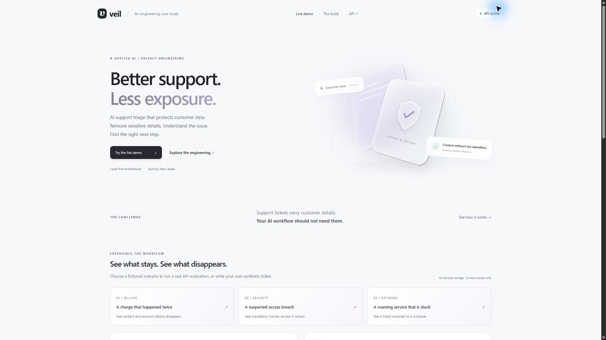
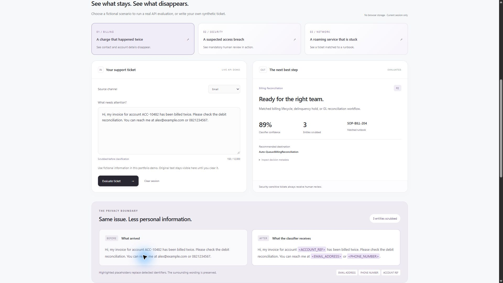

# Veil - Privacy-First AI Support Triage

A self-directed engineering portfolio project by **Neo Leope**. Veil demonstrates a support workflow that removes supported sensitive identifiers before retrieving operational context and classifying tickets.



## What you can try

Run the app locally, select a synthetic billing, security, or network ticket, and inspect:

- Original and sanitized text side by side, with replacement tokens highlighted.
- Classification, priority, confidence estimate, and matched operational runbook.
- Recommended queue and mandatory human review for security incidents.
- A response audit identifier. No production audit persistence or queue dispatch is implemented.



## Implementation

| Layer | Implemented behavior |
| --- | --- |
| API | ASP.NET Core / .NET 8; `POST /api/v1/triage`, `GET /api/v1/health`, Swagger |
| Redaction | Regex patterns for supported South African IDs, emails, phone numbers, payment-card-like numbers, and account references; optional local Presidio analysis/anonymization |
| Retrieval | Four seeded operational runbooks, ranked in memory by keyword overlap |
| Classification | Local Ollama OpenAI-compatible endpoint, with deterministic keyword fallback when unavailable or unsuccessful |
| Review policy | Security incidents or confidence below the configured threshold (default 0.85) return a human-review destination |
| Frontend | Dependency-free HTML, CSS 3D artwork, and JavaScript; no browser ticket persistence |
| Evaluation | xUnit synthetic dataset and regression tests; Node frontend interaction tests |

### Boundaries and unfinished extensions

This is a prototype, not a compliance certification or a claim that all personal information is detected. Regex redaction does not recognize every identifier or contextual name; contextual detection depends on Presidio. Confidence is a classifier estimate, not measured accuracy. A fallback decision is not evidence that an LLM ran.

The repository includes PostgreSQL/pgvector schema scaffolding and an MCP tools sketch. The active retriever does **not** use vector search, audit decisions are **not** written to PostgreSQL, and the MCP sketch does **not** implement a running protocol transport or a durable queue. These are future integration points.

## Run locally

Requirements: .NET 8 SDK or newer compatible SDK. Node.js is needed only for frontend checks. Docker is optional for the local service integrations.

```powershell
dotnet run --project src/Triage.Api
```

Open the HTTP address printed by the application (default launch profile: `http://localhost:32485`). The interface is at `/`, with API documentation at `/swagger`.

For local Ollama and Presidio integration:

```powershell
docker compose up -d
docker exec triage-ollama ollama pull llama3.2:3b
```

`docker-compose.yml` contains a **local-development-only** PostgreSQL password, not a production secret. The database is currently unused by the running triage flow. Supply production credentials through environment variables or a secret store if adding persistence. Never reuse the development password in a public deployment.

## Validate

```powershell
dotnet test tests/Triage.EvalTests/Triage.EvalTests.csproj
node --test tests/Frontend/portfolio.test.cjs
```

Five synthetic golden tickets check the expected removal of specified sensitive values, category, priority, and review outcome. Two additional backend checks verify supported value replacement and preservation of non-sensitive text. Five simulated-DOM frontend checks cover one-click submission, safe highlighting, session clearing, stale-result invalidation, and recoverable errors.

These tests are bounded examples, not population-level accuracy measurements. The included screenshots show an actual local billing evaluation: three identifiers removed, billing category, P2 priority, and SOP-BILL-204.

## Hosting

The full app needs a .NET-capable host plus any chosen local-service integrations. GitHub Pages alone cannot execute the .NET API. A Dockerfile is included for container hosting; configure endpoint URLs to reachable services instead of `localhost` when they run in separate containers. Do not publish a static copy and describe it as a working AI backend.

The public-facing portfolio should use synthetic examples. Before accepting real customer data, add authentication, request limits, service-failure policy, privacy review, and operational monitoring appropriate to the deployment.

## Project structure

- `src/Triage.Api`: working API, service orchestration, and frontend
- `tests/Triage.EvalTests`: synthetic evaluation and backend regressions
- `tests/Frontend`: dependency-free interaction checks
- `src/Triage.McpServer`: MCP integration sketch
- `infra`: optional database schema scaffolding
- `docs/screenshots`: actual local demo captures

## License

No open-source license has been selected. Source is shared for portfolio review; no additional reuse rights are granted beyond applicable law and GitHub's platform terms.
